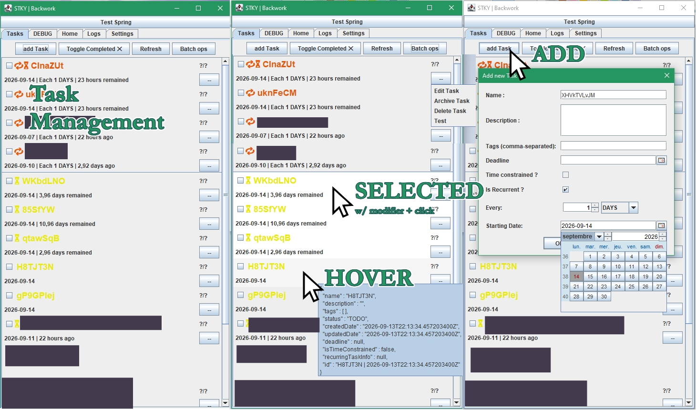
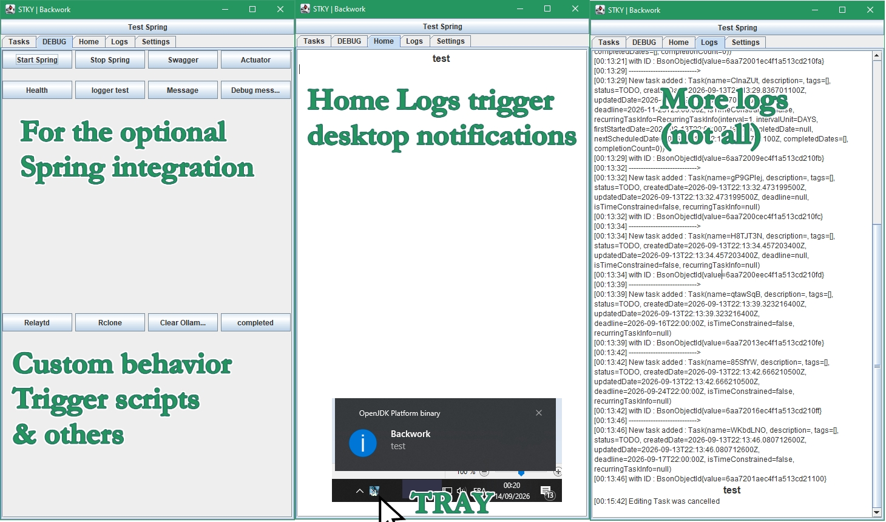

<> Some kind of application for background work <>

### Main Technical Stack

Java 25  
Spring Boot 4    
Maven  
MongoDB  
Java Swing

### Implementation feature

#### Main

Back-end
> - CRUD Operation with MongoDB database
> - DTO (Data Transfer Object) Usage because of date and ids
> - Swagger integrated
> - Scheduling (with Spring)
> - Logging with Logback

GUI
> - Swing
> - Desktop notifications
> - 4 Tabs
    2 Console, 1 is for debugs
> - Panel of buttons for various logic
> - Task Panel
    - Add Task (popupdialog), hide-unhide completed, SFX on task completion,
    - Separated normal tasks and recurring tasks
    - Edit and delete tasks
    - Select Task and apply a batch action
    - onHover behavior for component and their child
    - Display time remaining, loop interval, and indicator

#### Deprecated

-

#### Comments

- Using Java Swing because I want a ligthweight GUI
- Trying to use native Java as much as possible and be less reliant on external frameworks/dependencies
- Need : lightweight solution to watch youtube video in backgrounds
    - > Swing doesn't have webview nor solution for yt videos, Introducing JFXPanel (Java FX) is against current
      philosophy of being lightweight
    - > JCEF (Java Chromium Embedded Framework) Webview but heavy on RAM
    - > Current solution : external browser

#### Plan

*

### Others

*